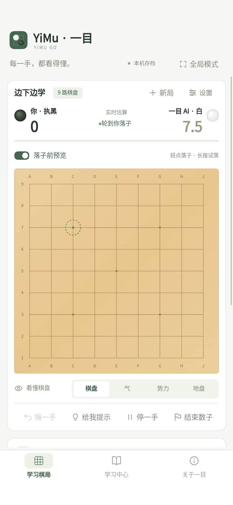
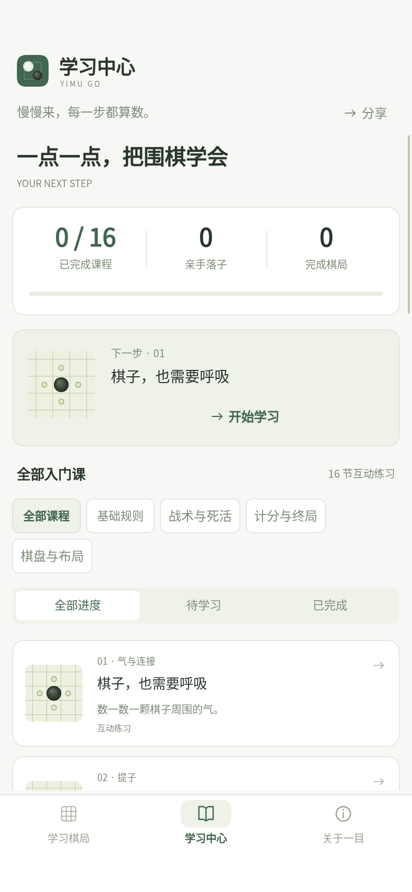
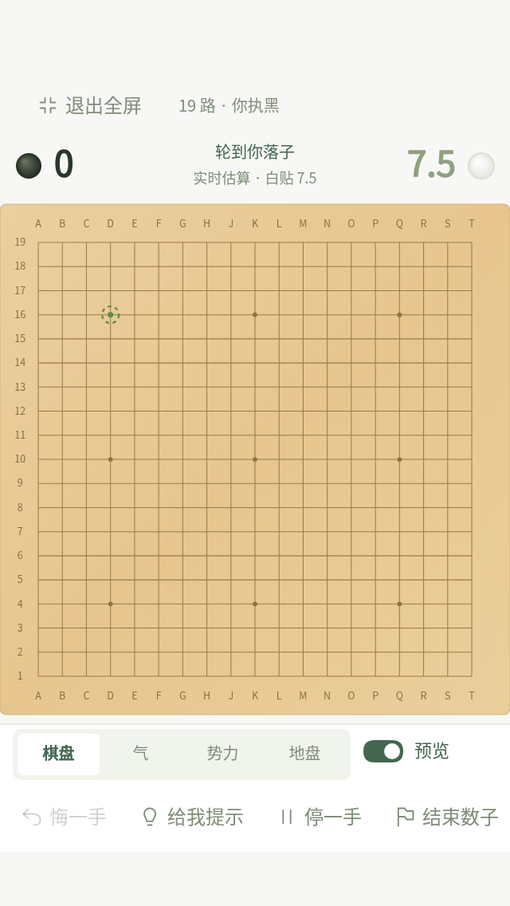

# YiMu · 微信小游戏版

**适用于小游戏 AppID，以及开发者工具显示 `mg` 的环境。** 本工程使用真正的 `game.js` / `game.json` 入口，界面由 Canvas 2D 绘制，不依赖普通小程序的 App、Page、WXML、WXSS 或浏览器 DOM。

## 直接导入：你现在应使用这个目录

1. 更新仓库，或解压下载的 **YiMu-minigame** 项目包。
2. 回到微信开发者工具的项目列表，选择「小游戏」下的导入项目。
3. **导入仓库中的 `wechat-game/`**。使用压缩包时，选择同时包含下列文件的目录，不要导入旧的 `wechat/` 或 `wechat/miniprogram/`：

   ```text
   project.config.json
   game.js
   game.json
   src/
   shared/
   utils/
   workers/
   ```

4. 填写你已经注册的**小游戏 AppID**。仓库默认 `touristappid` 仅是本地占位，正式上传需使用真实小游戏账号。
5. 配置应为 `"compileType": "game"`、`"miniprogramRoot": "./"`。小游戏入口就在项目根目录，不能沿用旧工程的 `miniprogram/` 代码目录。
6. 选用当前稳定基础库。`mg` 环境正是本工程对应的运行环境；项目未锁定基础库版本，实际兼容性仍需在开发者工具和真机中验收。
7. 点击编译，随后使用预览功能在安卓、iPhone 上测试。

如果工具仍寻找 `miniprogram/game.json`，说明仍加载了旧目录、旧项目记录或本地错误配置。请检查导入目录，以及 `project.private.config.json` 中的代码根目录覆盖项；必要时移除工具中的旧项目记录后重新导入，保留源文件。无需在旧的小程序目录补空的 `game.json`。

压缩包包含已生成的共用代码，可以直接导入，不需要在压缩包内运行 npm。**以下构建命令仅用于完整 GitHub 仓库根目录。**

## 界面预览 · 1.5.2

小游戏沿用网页版的米白、苔绿与木色：棋手、比分、预览开关和操作整合在棋盘卡片内；视图使用轻量分段切换，底部使用图标导航。学习中心增加课程棋形缩略图，设置与讲解使用随内容调整高度的弹层。

<p> </p>

以上由实际应用 Canvas 渲染器在模拟平台环境中生成，供对照布局，并非微信真机截图。轻点落子、可关闭的长按预览、AI、计分和全部课程的操作方式保留。

全屏模式隐藏品牌与标语，比分压缩为一行，棋盘按完整可用宽度和剩余高度取最大正方形，操作栏固定于底部安全区域上方。320×568 屏幕可显示 320px 棋盘，无需滚动；微信系统胶囊和安全区仍予以避让。关于页已移除网页版和开源项目链接入口，保留隐私说明及本机数据清除。



## 功能与操作

- 9／13／19 路棋盘、选择执黑或执白、三档本地 AI 搜索；AI 使用小游戏 Worker。
- 轻点立即落子。长按约 0.4 秒查看预览，按住拖动换点，松手收起且不落子。预览可关闭。
- 长按前滑动用于滚动页面，不会变成落子；双指与系统取消会终止手势。
- 气、势力、地盘视图；全屏模式保留完整棋盘和主要对局操作，退出全屏后可设置或开启新局。
- 实时估算、落子讲解、推荐依据、可能应手和搜索过的备选点。点击比分或讲解卡片进入详细说明；长内容可上下滑动阅读。
- 悔棋、停一手、双方连续停一手进入数子、整块标记死棋、中国规则面积计分与白贴 7.5 点。保存结果后锁定，完成棋局只累计一次。
- 学习中心统一展示课程和统计，按主题与完成状态筛选，继续第一节未完成的课程。
- 全部 16 节课程，包括劫、公活、死子标记、停一手、19路坐标和三四路布局，均在小游戏 Canvas 内完成交互。
- 本机棋局和学习进度、课程分享、隐私说明、清除本机数据。

页面和弹层支持上下滚动。切到学习中心、关于页或进入后台会终止 Worker，迟到结果不会落子；返回棋局时，如仍轮到 AI，会重新搜索。全屏模式切换不中断 AI。

## 开发与共用逻辑

在完整仓库根目录运行：

```sh
npm ci
npm run build:wechat-game
npm run check:wechat-game
npm test
```

`build:wechat-game` 从网页版规则、课程、AI 搜索与普通小程序的纯函数工具生成小游戏所需 CommonJS 文件。生成结果已经提交，正式运行不依赖其他目录。

| 文件 | 来源 |
| --- | --- |
| `shared/engine.js`、`workers/engine.js` | `dist/engine.js` |
| `shared/lessons.js` | `dist/lessons.js` |
| `workers/search.js` | `dist/ai.js`，计时适配为 Date.now() |
| `utils/*.js`、`workers/ai.js` | `wechat/miniprogram/` 中的平台通用会话、课程、存储、手势和 Worker 入口 |

不要直接编辑标有 Generated 的文件，修改来源后重新构建。小游戏专属的启动、界面、触摸路由、滚动与生命周期位于 `game.js`、`src/`。

## 三个版本如何选择

| 版本 | 目录 | 入口 | 适用账号 |
| --- | --- | --- | --- |
| 网页版 | `dist/` | `index.html` | 浏览器访问 |
| 普通微信小程序 | `wechat/` | `miniprogram/app.js`、`app.json` | 普通小程序 AppID |
| **微信小游戏** | **`wechat-game/`** | **根目录 `game.js`、`game.json`** | **小游戏 AppID** |

小游戏使用 Canvas 场景导航，没有 WXML 页面；不能通过修改 compileType 把两个工程相互转换。

## 发布前仍需你完成

- 在导入界面或 `project.config.json` 填写真实小游戏 AppID，配置开发者／体验者。
- 按账号的实际游戏类目与平台要求确认所需资质、备案、健康系统／防沉迷、隐私配置等发布事项。本工程完成技术适配，不表示已取得平台上线资格。小程序的备案说明不能替代小游戏发布要求。
- 在 `config.js` 中按实际情况填写公开联系方式及真实备案展示信息；不要使用示例备案号。
- 配置正式名称、头像、简介、审核截图和审核说明。
- 在微信开发者工具与安卓／iPhone 上进行真机测试，再上传体验版、提交审核和发布。GitHub 或 Vercel 更新不会代替微信上传／审核。

没有把任何 AppSecret、上传密钥或账号证件写入工程。个人 `project.private.config.json` 已被 Git 忽略。

## 数据与验证范围

本版本无需登录、后端或外部 AI Key，不接入广告、统计 SDK 或网络字体。计算和存储均在本机。窗口尺寸与安全区仅用于布局，分享只含首页或课程入口。不同 AppID、设备、网页版、普通小程序之间不会自动同步数据。

测试覆盖真实小游戏入口启动、Canvas 触摸／命中区域、长按拖动、滚动取消、多指、只读推荐、弹层滚动、AI 失效结果拦截、后台恢复、设置、数子、清除存档、全部16课和分享入口。

开发环境使用模拟微信 API 和 Canvas 绘制预览，**没有运行 macOS 微信开发者工具或进行微信真机验收**。代码绘制预览不等于真机截图。首次导入后，请重点测试启动、中文字体、9／13／19路精确落子、长按与滚动、AI三档、切后台、学习进度、分享和小屏全屏模式。
